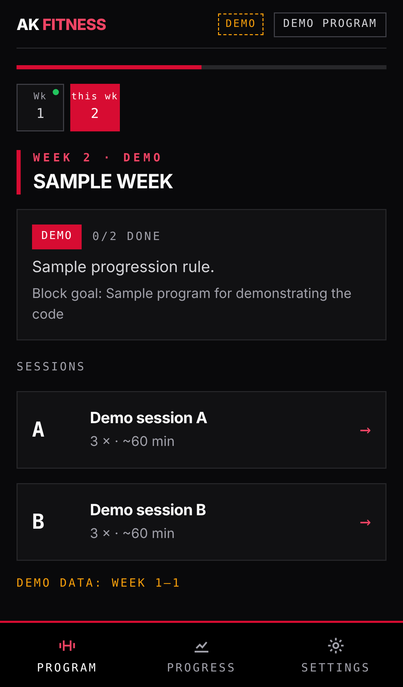
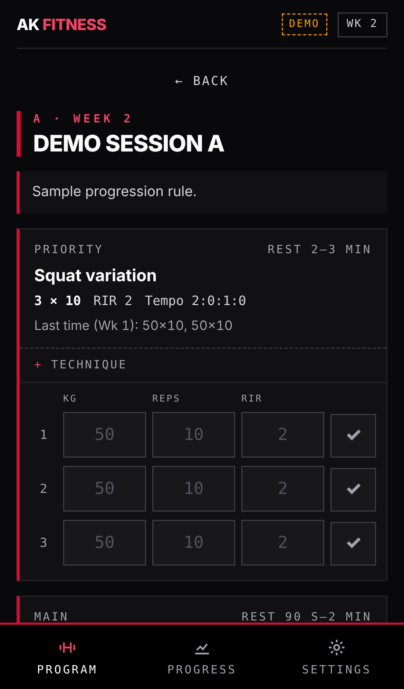
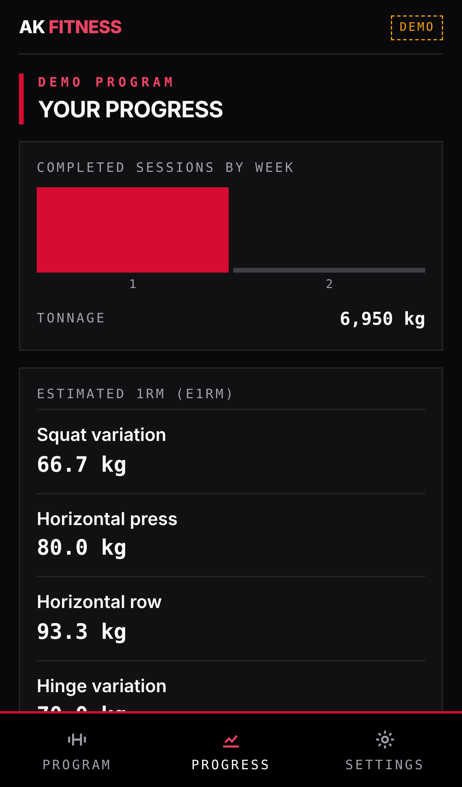
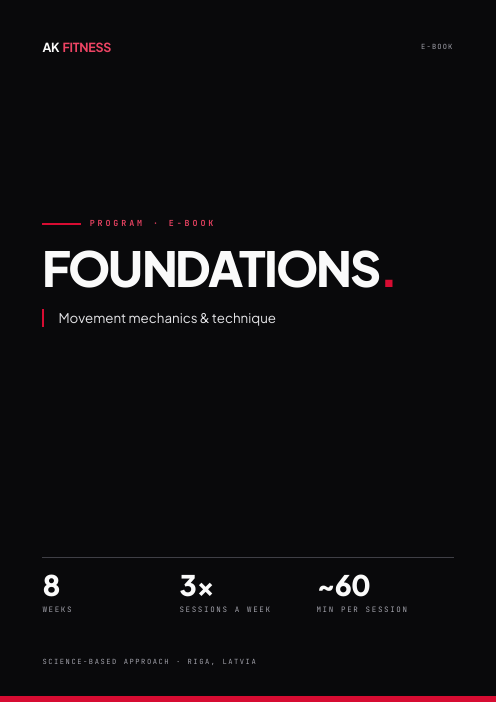
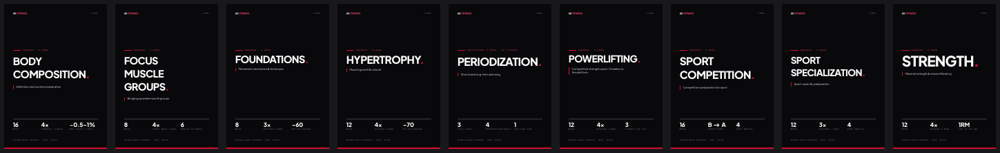
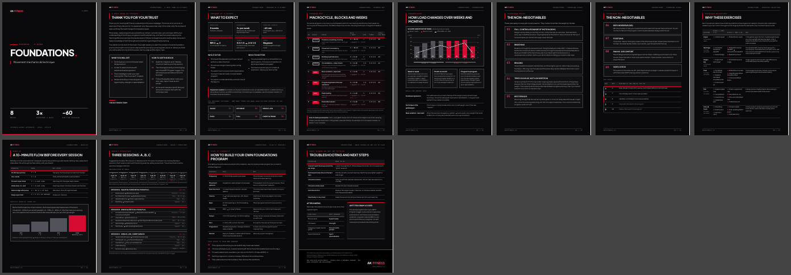
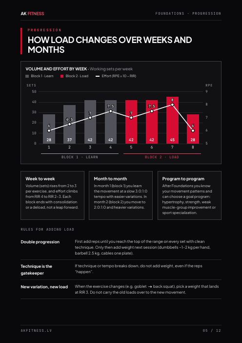

# AKFIT Programs · e-books + Program Logger

A one-off training-program product built from a single source of truth: each program is written once as structured data, and that data generates both a **designed PDF e-book** (Latvian and English) and a **mobile workout logger** the client trains with.

Built for **AK Fitness**, an online coaching business in Riga, Latvia.

<p>
  
  
  
  
</p>

## The problem

Most programs sold online are bare exercise lists. The coaches wanted a product that also **teaches**: why these exercises, how progression and periodization work, so a client can eventually plan their own training. Two constraints shaped it:

- **No coaching platform seat per buyer.** Assigning a program in the coaching app (CoachRx) counts the buyer as a coaching client, which uses up paid capacity. The product needed its own way for clients to follow and log the program.
- **Two languages, many programs, one small team.** Hand-laying 18 PDFs and keeping them in sync with a logging app would not survive the first edit.

## What I built

### 1. Program data model (`akfit-program/2`)

Every program is one JSON document. A program has blocks (phases), weekly notes with a focus and a progression rule, roles (priority / main / support…) whose prescription changes week by week, and sessions whose exercises swap variants between blocks. All text is bilingual (`{ "lv": …, "en": … }`). Personal programs add **modules**: a base program plus one module the client picks, for example a focus muscle group or a sport.

Two intensity models are supported: **RIR** (reps in reserve) and **percentage of 1RM**, where the client enters their maxes and the logger calculates the loads.

See [`docs/program-schema.md`](docs/program-schema.md) and the demo program embedded in `index.html`.

### 2. E-book generator

A Python engine renders each program into HTML in the brand's dark design system, and headless Chrome prints it to PDF. The result is 9 programs × 2 languages = 18 e-books of 12–13 pages each, all built from the same data the logger uses.



Details that mattered for print quality:

- **Fonts embedded, never fetched.** The brand fonts come from `@fontsource` packages through `file://` URLs, so every PDF embeds exactly Plus Jakarta Sans and JetBrains Mono (checked with `pdffonts`).
- **No silent fallback fonts.** The brand fonts lack glyphs such as arrows, ≤, ≥, ≈ and ⅓. Each one is swapped for an inline SVG or a word, so a stray system font never appears mid-sentence.
- **Automatic overflow check.** A second headless-Chrome pass (`--dump-dom`) runs an in-page script that reports any element spilling past its page, so a long translation can't silently push content off the page.
- **Visual review at scale.** Every page is rasterised with `pdftoppm` and tiled with ImageMagick `montage` for a one-screen check of a whole book.





The e-books explain the method in depth; exercise detail stays short on purpose (a one-page session overview), and the full prescriptions live in the logger.

### 3. Program Logger (`index.html`)

A mobile-first web app in a single HTML file: no framework, no build step.

- **Week and session views** with the prescription for that week (sets × reps, RIR or %1RM, tempo, rest), technique cues and an easier option for each exercise.
- **Fast logging:** each set is pre-filled from the prescription and from what the client lifted last time, so most sets take one tap.
- **Session effort (RPE) and notes**, a rest timer, and a progress view: completed sessions per week, total tonnage and estimated 1RM for each main lift.
- **Latvian and English**, switchable at any time.
- **Offline-first:** everything is saved on the device first, then synced in the background. If the network fails, the client sees "saved on device, will sync later" and keeps training.
- **Demo mode:** with no backend configured, the app runs fully on the device with seeded example history, which is how it was tested and how the screenshots above were made.

**Backend contract.** Set `API_BASE` to a webhook base URL and the logger uses two endpoints, designed to be served by n8n:

| Endpoint | Request | Response |
|---|---|---|
| `POST /akfit/login` | `{ email, code }` (the code comes in the purchase email) | `{ token, programId, startDate, module, oneRM, logs, lang }` |
| `POST /akfit/sync` | `{ token, logs, settings }` | `200 OK` |

## What's in this repo

```
index.html               the Program Logger, with one demo program
docs/program-schema.md   the program data model
previews/                logger screenshots and e-book previews
```

**What's deliberately not here:** the nine real programs and the e-book PDFs are a paid product, so this repo contains only a two-week demo program with generic exercises, and the e-books are shown as previews. The e-book generator is not included either, because its program files are the product content.

## Running it

Open `index.html` in a browser (a phone-sized window works best) and press **Open demo**. Data stays in that browser's local storage.

## Stack

JavaScript, HTML and CSS (logger) · Python + headless Chrome (e-book pipeline) · poppler-utils and ImageMagick (PDF checks) · n8n (planned backend)

## Status and next steps

The e-books for all 9 programs and the logger in demo mode are done.

Next:
- n8n backend: purchase email with a login code, login and sync endpoints, storage per client
- coaches' review of the programming content before launch
- generate the logger's program data and the e-books in one build step, so they can never drift apart
